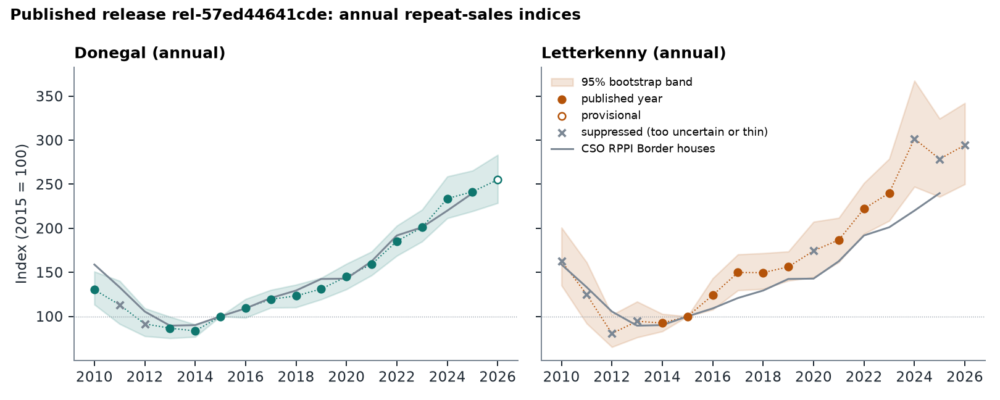
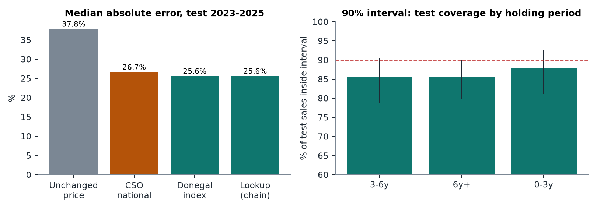
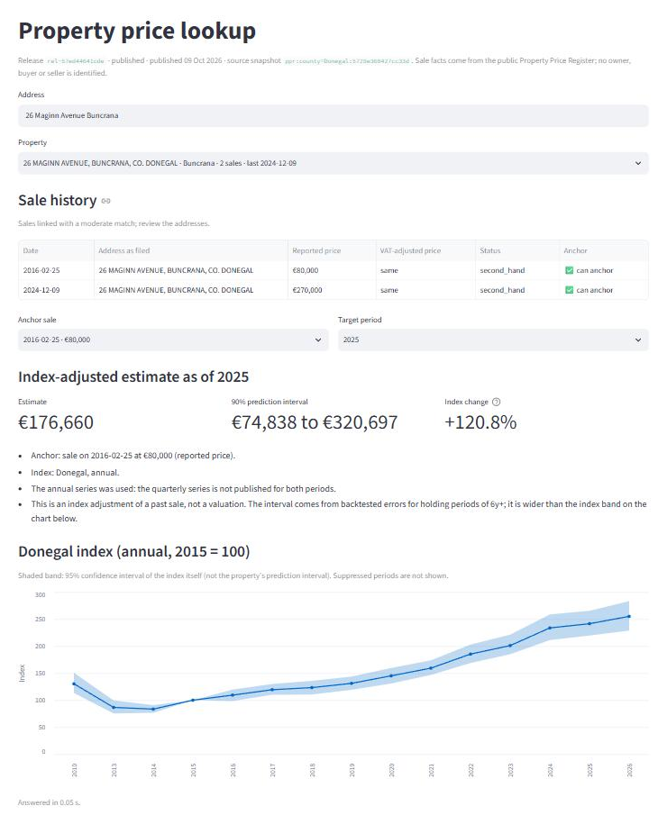
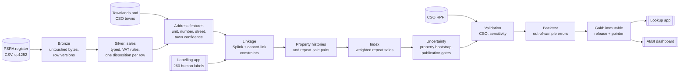

# Repeat-Sales House Price Index for Donegal, on Databricks

[](https://github.com/mccoolsa/Repeat-Sales-Index-DB-/actions/workflows/ci.yml)

Ireland publishes every residential property sale since 2010, but the register has no ID for
the home itself, so you cannot simply follow one house through time. This project links sales
of the same home, builds a quality-gated **repeat-sales house price index** for Co. Donegal
from them, and serves it through a lookup app that answers one question honestly:

> *"What does this home's last sale price mean in today's market, and how sure can we be?"*

Everything runs end to end on **Databricks** (Unity Catalog, Delta, Asset Bundles, serverless
Jobs, MLflow, Databricks Apps, AI/BI dashboards), and identically on a laptop with DuckDB.



## Results

| | |
|---|---|
| Register rows → index-eligible sales (Donegal) | **21,484 → 19,545** |
| Repeat-sale pairs used by the index | **1,224** pairs from 1,113 homes |
| Property-link precision, from 260 hand-labelled pairs | **98.0%** (95% CI 95.6 to 99.7%), recall 75% |
| Donegal index, 2026 (2015 = 100) | **255.1** (95% CI 228.7 to 283.3, provisional) |
| Year-on-year growth vs the official CSO regional index | **+0.3 pp** average bias over published years |
| Out-of-sample price error, test sales 2023 to 2025 | **25.6%** median, vs 26.7% with the CSO national index and 37.8% unadjusted |
| 90% prediction interval coverage on test sales | 85.6 to 88.0% by holding period |
| Full monthly refresh on serverless | about 10 minutes, 11 tasks |

Current release: `rel-57ed44641cde` (published, register to 2 October 2026), identical on Databricks and locally.



## The lookup app



Search an address, check the home's recorded sales, and bring a past price forward with the
index. Every estimate states which sale it starts from, which index it used, how wide the
uncertainty is, and when no fair number exists it says why (`UNSUPPORTED_PERIOD`,
`NO_ELIGIBLE_ANCHOR`, ...) instead of guessing. It is an index adjustment, not a valuation.

## How it works



1. **Ingest without trusting the source.** The register is downloaded inside a Databricks job,
   stored byte for byte in a Unity Catalog volume and landed in Delta with one row per
   occurrence (exact duplicate rows are kept, not silently dropped). Each snapshot is
   reconciled against the previous one and only promoted if it passes checks, and the stored
   table can be rebuilt byte-identically from the saved file.
2. **Clean with an audit trail.** Every one of the 21,484 rows ends in exactly one state:
   eligible, excluded or pending review, each with a reason code. VAT-exclusive new-build
   prices are adjusted with date-effective rules, and bulk "many units for one price" filings
   are held back.
3. **Link sales into homes.** Blocking keeps 47k plausible candidate pairs out of 230 million.
   A Fellegi-Sunter model (Splink) scores them on unit, number, street, town, townland and
   Eircode, never on price. Links are then added strongest first, and any link that would put
   two flat numbers, two Eircodes or two same-day prices into one home is refused, which
   stops chains like A-B-C from merging an apartment block. I labelled 260 stratified pairs in
   a Databricks App to measure precision and choose the threshold.
4. **Estimate the index.** Case-Shiller three-stage weighted repeat sales: OLS, a model of how
   pair noise grows with holding time, then weighted least squares. Periods that are not
   connected to the base year fail loudly rather than being spliced in. Synthetic tests check
   that all four estimators recover a known index.
5. **Publish only what the evidence supports.** Confidence bands come from a bootstrap that
   resamples whole homes (a home with three sales gives two dependent pairs). A series needs
   at least 300 homes and a year needs 20 pairs and a band narrower than about ±15%; those
   thresholds were set by downsampling Donegal. Quarterly Donegal and recent Letterkenny years
   fail, so the app falls back to Donegal annual and says so.
6. **Validate and backtest.** Growth is compared with the CSO's official Border houses index.
   Property estimates are tested on later sales of homes the index never saw, with
   development, calibration and test windows split by time.
7. **Release like software.** Each stage is versioned by a hash of its inputs, code and config.
   A release is immutable and the app and dashboard both read whichever release the
   append-only pointer selects. Gate-failure, rollback and roll-forward drills were run on
   Databricks.

## Stack

Python 3.12 · pandas · NumPy · SciPy · statsmodels · Splink 5 · DuckDB · Databricks (Unity
Catalog, Delta Lake, serverless Jobs, Asset Bundles, MLflow, Apps, AI/BI dashboards, SQL
warehouse) · Streamlit · pytest (265 tests) · ruff · GitHub Actions

## Run it

Requires Python 3.12.

```bash
python -m venv .venv && .venv/Scripts/activate        # or: source .venv/bin/activate
pip install -r requirements-lock.txt && pip install --no-deps -e .
pytest -q
```

Local pipeline (DuckDB). The register is public: download `PPR-ALL.zip` from the
[Property Price Register](https://www.propertypriceregister.ie) into
`data/raw/ppr/<date>/` without opening or re-saving it (it is Windows-1252 encoded).

```bash
python jobs/ingest_ppr.py --target local --profile donegal --saved data/raw/ppr/<date>
python jobs/run_pipeline.py --profile donegal --start clean     # clean ... publish
RSI_LOCAL_DUCKDB=data/warehouse/donegal.duckdb streamlit run app/lookup/app.py
```

On Databricks (any workspace, including Free Edition, with a CLI profile named `ireland-rsi`;
one-time catalog setup is in [docs/runbook.md](docs/runbook.md)):

```bash
databricks bundle deploy -t donegal
databricks bundle run ingest_ppr -t donegal     # full refresh, 11 tasks
databricks bundle run lookup -t donegal         # start the lookup app
```

## Repository

```
config/            source contract, cleaning rules, profiles, index and publication policy
src/ireland_rsi/   ingest, clean, addresses, labels, linkage, entities, pairs, index,
                   uncertainty, geography, validate, backtest, publish, pipeline, storage
jobs/              one entry point per stage (local or Databricks) and the local runner
app/               labelling and lookup Streamlit apps (Databricks Apps)
dashboards/        governed SQL views and the AI/BI dashboard definition
sql/               catalog setup and least-privilege grants
docs/              methodology, decisions, stage reports, runbook, user guide, PDFs
tests/             unit, property and integration tests (DuckDB stands in for Delta)
```

| Document | |
|---|---|
| [Methodology](docs/methodology.md) | Method, evidence and limitations in one place |
| [Decision log](docs/decisions.md) | 31 recorded decisions with their evidence |
| [Release report (PDF)](docs/donegal_release_rel-57ed44641cde.pdf) | Published index, worked examples, evidence |
| [Project brief (PDF)](docs/project_brief.pdf) | 10-page overview |
| [User guide](docs/user_guide.md) | Who it is for and how to read a result |
| Stage reports | [source audit](docs/source_audit.md) · [quality](docs/quality_report.md) · [addresses](docs/address_report.md) · [linkage](docs/linkage_report.md) · [pairs](docs/pairs_report.md) · [index](docs/index_report.md) · [uncertainty](docs/uncertainty_report.md) · [validation](docs/validation_report.md) · [backtest](docs/backtest_report.md) |

## Limitations

- **Precision is 98%, not 99%.** Three of the four wrong links are generic apartment addresses
  in different towns ("Apt 1, Bridge St" in two towns). A fix is proposed but deliberately not
  tuned on the same labels used to measure it.
- **Labels come from one reviewer.** A second reviewer on a subset would give an agreement rate.
- **Repeat sales are not all homes.** Homes that sold twice since 2010 differ from the stock
  (older rural Donegal sales are under-represented), which the reports quantify.
- **Prediction intervals slightly under-cover** (86 to 88% against a 90% target).
- **Scope is Donegal.** The same code runs nationally (the `national` profile, 809k rows,
  through linkage); national scale would first need incremental linkage.

## Data and licences

- Property sales: [Property Services Regulatory Authority](https://www.propertypriceregister.ie),
  Residential Property Price Register. Raw data is not redistributed in this repository.
- Benchmark: Central Statistics Office, Residential Property Price Index (HPM09, HPQ01),
  [CC BY 4.0](https://www.cso.ie/en/aboutus/whoweare/copyrightpolicy/).
- Place names: Tailte Éireann townlands, and CSO Census 2022 Built Up Areas, CC BY 4.0.

The register identifies no buyer, seller or owner. The lookup app runs behind Databricks
sign-in.

Built by Conor McCool.
